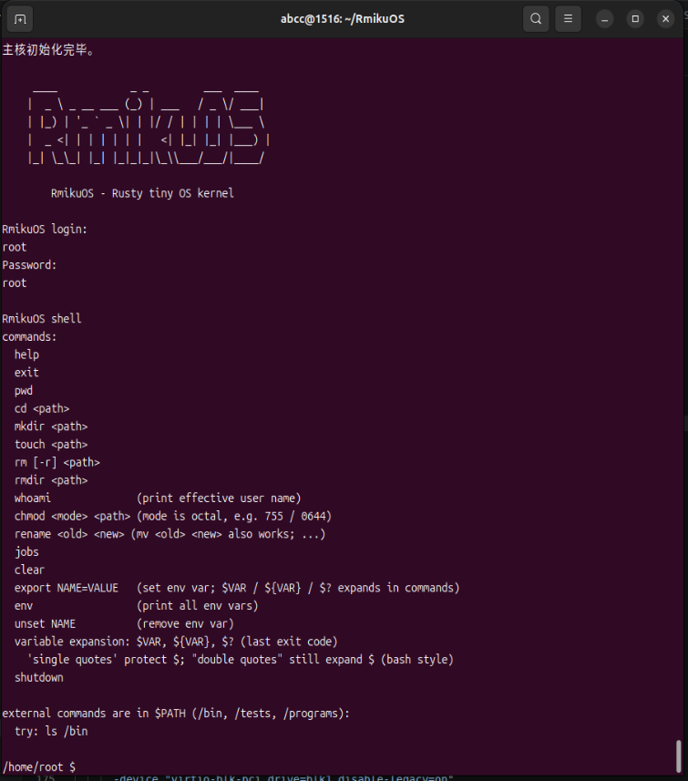

# RmikuOS

[](https://github.com/amieon/RmikuOS/actions/workflows/ci.yml) [](https://opensource.org/licenses/MIT)

RmikuOS 是一个从零实现的教学型操作系统内核,支持 **RISC-V 64** 与 **LoongArch 64** 双架构。它可以在 QEMU 上启动用户态 shell,从真实 virtio 块设备加载 ext4 rootfs,并运行 **C / C++ / Rust / Java / Lua / Scheme** 六种语言的用户程序,内置 **TCC（Tiny C Compiler）** 可在系统内现场编译并运行 C 程序（AOT + JIT 双模式）,配备 **kilo 全屏编辑器**（ANSI 终端、语法高亮）——编辑、编译、运行完整闭环,还内置 **SQLite 3.50 交互式数据库**（自定义 VFS 落盘，数据可持久化到 FAT 磁盘）,并通过自研 TCP/IP 协议栈（含 DHCP 自动配置与租约续期、DNS 域名解析）向宿主机浏览器提供真实的 HTTP 服务。系统内还跑得动 **git 2.33.1 + OpenSSL 3.0 + curl 8.23.0**:HTTPS 带证书校验,`git clone https://` 全链路在 guest 内完成;同时补齐了完整 POSIX 信号模型、`pthread`/futex 线程同步与线程私有数据、C++ 全局构造析构、文件映射与亚秒墙钟。

RmikuOS 的目标不是停留在 `Hello, world`，而是逐步构建一个小而完整、能运行真实用户程序、能承载系统实验的教学型 OS。作为验证，独立项目 [VeryEasyGCN](https://github.com/amieon/VeryEasyGCN) 已通过 `stdcompat.h` 桥接层移植到 RmikuOS 上运行，并在真实 Cora 数据集上达到 **78.3%** 测试准确率。

```text
 ____            _ _         ___  ____
|  _ \ _ __ ___ (_) | ___   / _ \/ ___|
| |_) | '_ ` _ \| | |/ / | | | | \___ \
|  _ <| | | | | | |   <| |_| |_| |___) |
|_| \_\_| |_| |_|_|_|\_\\___/___/|____/

        RmikuOS
```

---

## Screenshots



*Boot and Shell*

---

## 功能总览

| 子系统       | 能力                                                         | 备注                                                         |
| ------------ | ------------------------------------------------------------ | ------------------------------------------------------------ |
| 双架构       | RISC-V 64 + LoongArch 64,SMP 多核                            | virtio-mmio / virtio-pci                                     |
| 进程与线程   | `fork` / `exec` / `waitpid`、`thread_create` / `thread_exit` / `thread_join`、futex、`pthread` 互斥锁 / 条件变量 / `once`、TSD + 每线程 `errno` | 进程级 fd table,线程共享地址空间;内核每 TCB 一行 `tsd[128]` 存槽 |
| 信号         | 自定义 handler / `sigaction`、进程 + 线程两层 pending、信号屏蔽字、进程组投递、`SIGSTOP` / `SIGCONT`、`SIGPIPE`、`setitimer` / `alarm` | `waitpid` 按 `code<<8` / 低 7 位信号号编码;Ctrl+C 整条管线一起收 |
| 虚拟内存     | buddy 帧分配器、多级页表、ELF 加载、`mmap`(匿名 + 文件映射,`MAP_FIXED` / `MAP_FIXED_NOREPLACE`) | 文件映射当前为 eager 读,lazy 调页见 Roadmap                  |
| 文件系统     | VFS 多挂载:ext4 rootfs(只读) / 可写 ext4(rsext4 + JBD2 日志) / tmpfs / FAT32 | `openat` 家族 + `O_EXCL` + `umask` + `mkstemp`;数据盘 LABEL 身份识别 + 周期 writeback |
| 用户与组     | `useradd` / `groupadd` / `usermod` / `passwd` / `su` / `id`(身份类仅 root) | 账户库 defaults + overrides:可写 `/var/etc/{passwd,group}` 覆盖只读出厂 `/etc/{passwd,group}` |
| 调度器       | stride + alpha-scaled + AIMD / SPSA-AdamW 自适应             | 内置调度实验框架(exp00–exp05 + exp10,见 docs)                 |
| 网络         | 自研 TCP/IP:Ethernet / ARP / IPv4 / UDP / TCP / DHCP / DNS / ICMP,以及 TLS / HTTPS | TCP 11 态 + Jacobson/Karn RTO + `getsockopt`/`setsockopt` + 非阻塞 connect + `MSG_PEEK` + 用户态 httpd + 域名解析(TTL 缓存) |
| 系统时钟     | RTC / `/var/lib/rtcstamp`(fake-hwclock) / `ntpdate` 三级校时,`hwclock` 读写 stamp | `SYS_GET_EPOCH_US`(129) 提供亚秒 epoch;virtio-rng → `/dev/urandom` |
| 用户程序     | C / C++ / Rust / Java(JVM + 装载期 AOT)/ Lua 5.4 / Scheme,以及 git / openssl / curl | syscall ABI 语言无关;C++ 全局对象构造析构走 `.init_array`    |
| 系统内工具链 | TCC 0.9.28(AOT + JIT)、SQLite 3.50(自定义 VFS 落盘)、zlib 1.3.1(完整移植,`libz.a`:宿主 `-lz` / 系统内 `tcc -lz`)、kilo 编辑器、git 2.33.1 + OpenSSL 3.0 + curl 8.23.0(HTTPS) | `user/build.py` 统一构建三方件,用 libc ABI 哈希决定全量重编;编辑-编译-运行闭环 |
| 应用验证     | VeryEasyGCN(78.3% 准确率)、RmikuRay(定点光线追踪)、GCN/GAT   |                                                              |
| 回归测试     | `user/tests/` 下 62 个测试源码(55 C + 7 C++),`run_all` 一键批执行 | 双重门禁:构建期"源码 → ELF"、运行期"ELF → PASS/SKIP"         |

---

## 文档索引

主 README 只保留门面与索引,深度内容按主题拆到 `docs/`:

| 文档                                           | 内容                                                         |
| ---------------------------------------------- | ------------------------------------------------------------ |
| [docs/shell.md](docs/shell.md)                 | Shell 词法 / 管道 / 重定向 / 环境变量 / `$?` 展开,TCC 自托管工具链,kilo 编辑器 |
| [docs/filesystem.md](docs/filesystem.md)       | VFS 与 fd table,ext4 / tmpfs / FAT32,文件系统调用,virtio 块设备;`openat` 家族与 dirfd 的路径字符串取舍,`O_EXCL` / umask / `mkstemp` 的创建语义 |
| [docs/network.md](docs/network.md)             | 自研协议栈(ARP / IPv4 / TCP / UDP / DHCP / DNS / ICMP / NTP),socket + `poll()` ,UDP connect,DHCP T1/T2,listen backlog,httpd,wget;TCP RTO / CUBIC / Go-Back-N 三组网络实验 |
| [docs/user-programs.md](docs/user-programs.md) | C 分层库 / C++ `stdcompat.h` 桥接 / Rust `ulib` / 自研 JVM / Lua 5.4 / Scheme,堆分配器与裸运行时数学库 |
| [docs/scheduler.md](docs/scheduler.md)         | stride 与 alpha-scaled 调度机制,调度统计接口,SMP 与计时注意事项 |
| [docs/experiments/](docs/experiments/)         | 调度实验框架(schedlab)+ 7 篇完整实验报告:EDF 基线 / α 机制 / Edge Deadline / AIMD / 动态负载 / 相位 / SPSA-AdamW |
| [docs/report.md](docs/report.md)               | α 缩放调度旋钮的自适应控制：五类方法家族的受控对照研究 |

---

## CI/CD 持续集成

GitHub Actions 手动触发验证双架构(可选架构,打 `v` 标签另触发 release 任务):

```text
双架构交叉编译 -> rootfs 制作 -> QEMU 启动 -> 自动登录 -> 62 个测试源码全量回归 -> 检查汇总 -> shutdown 关机
                                            \-> 可写 ext4 崩溃一致性测试(kill -9 + journal 回放 + e2fsck)
```

* 流水线文件:`.github/workflows/ci.yml`;冒烟脚本 `scripts/smoke_test.sh`,崩溃一致性脚本 `scripts/crash_consistency_test.sh`
* 触发方式:仓库 **Actions** 页 → 左侧 **CI/CD** → 右侧 **Run workflow**,选择 `riscv64` / `loongarch64` / `both`
* 构建产物(内核 ELF + rootfs + FAT 镜像)自动缓存,二次运行大幅提速;rootfs 镜像默认 96 MiB(`FS_SIZE_MB` 可覆盖),`user/build.py` 以 libc ABI 哈希(`include/**/*.h` + `lib/*.{c,cpp,S}` + crt0 / ldscript)作缓存键——任一头变动,用户程序与 git / openssl / curl 全部重编,避免新旧 `.o` 混链
* 回归测试:进系统后 `run_all` 一键执行 `user/tests/` 下的 62 个测试源码(55 C + 7 C++;断言库 `user/include/test.h`,覆盖进程/线程/同步/信号/内存/文件系统/管道/syscall/at 家族/权限与 umask/临时文件/SQLite 落盘/zlib 压缩回环/数学库/printf/setjmp/C++ 容器与全局构造/语言运行时/时钟/RNG/git),任一失败即流水线红;`run_all` 只扫 `/tests`,未编译出的测试不会静默少跑——构建期 `scripts/check_test_coverage.sh` 逐个核对"源码 → ELF",运行期 `scripts/verify_runall.sh` 逐个核对"ELF → PASS/SKIP"
* 崩溃一致性测试:`bigwrite` 写大文件到一半时 `kill -9` QEMU 模拟掉电,再用同一块数据盘重启,断言 journal 自动回放、`/home` 重新绑定成功、已 sync 数据仍在,最后用宿主机 `e2fsck -fn` 校验磁盘结构干净——把"JBD2 真的在工作"从一次性手工实验变成每次触发都验证的事实(测试用 `/tmp` 下的临时数据盘,不碰 `target/data-*.img`)
* 打 `v` 开头的标签(如 `v1.0`)时,自动构建双架构 release 产物并上传 GitHub Release

---

## 环境搭建

### Docker(推荐)

```bash
docker build -t rmikuos-dev .
docker run -it --rm -v $(pwd):/work -p 8080:8080 rmikuos-dev
```

> 构建默认使用本地 cross-tools/ 目录中的 loongarch64 工具链。
> 没有的话,先从 loong64/cross-tools releases(https://github.com/loong64/cross-tools/releases)下载 x86_64 宿主版,解压后将 loongarch64-unknown-linux-gnu 里的内容移至 ./cross-tools。

### 无 Docker

```bash
bash first_run.sh   # 自动装 apt/rustup/工具链
```

之后这样就行:

```bash
./run.sh riscv64
./run.sh loongarch64
```

日常增量构建直接用上面两条;改了 `user/include/**/*.h`、或怀疑新旧产物串味时,用 `rebuild` 清掉全部用户态缓存重编(`--stages=lib,bin` 决定 OpenSSL 跑哪些脚本阶段,`FORCE_KERNEL=1` 才连内核一起 cargo clean)。QEMU 的 TCG 线程模型与 vCPU 数可用 `TCG_THREAD` / `SMP_N` 覆盖:

```bash
./run.sh riscv64 rebuild --stages=lib,bin
SMP_N=4 TCG_THREAD=multi ./run.sh riscv64 debug
```

---

## Build and Run

### RISC-V 64

```bash
./run.sh riscv64 debug      # Debug
./run.sh riscv64 release    # Release
```

RISC-V 使用 QEMU `virt` 机器和 virtio-mmio 块设备。

### LoongArch64

```bash
./run.sh loongarch64 debug      # Debug
./run.sh loongarch64 release    # Release
```

LoongArch64 使用 QEMU `virt` 机器和 virtio-pci 块设备。

> 注:在 QEMU 软件模拟下,loongarch64 的指令翻译、串口 IO 与多 vCPU 执行效率可能明显低于 riscv64;日常开发建议以 riscv64 为主,loongarch64 用于跨架构正确性验证。

---

## Source Layout(用户程序与 rootfs 布局)

```text
user/
├── rootfs/                 rootfs 目录模板(etc/motd, home, share, tmp, fat ...)
├── include/                C/C++ 用户库(分层头文件,types/syscall/flag/io/process/fs/mem/lock/thread/sched/ipc/net/string/fmt/env + user.h 汇总)
│   └── my/                 C++ 桥接层与裸运行时库(stdcompat.h / cmath.h / vector.h ...)
├── lib/                    crt0 与 syscall_<arch>.S、cpp_runtime.cpp
├── src/                    C 系统程序 → /bin(ls / cat / echo / grep / head / wc / shell / nslookup)
├── tests/                  C / 单文件 Rust / 单文件 C++ 测试程序 → /tests
├── samples/               单文件示例程序(108 个:88 C + 16 C++ + 3 Rust + 1 汇编)→ /samples,自动 glob
├── c/                      C 项目型构建目录(多文件工程 httpd、lua)→ /programs
├── cpp/                    C++ 项目型构建目录(装载期 AOT 的 JVM)→ /programs
├── gcn/                    C++ 图神经网络项目(GCN/GAT)→ /gcn
├── java/                   Java 程序源码(.java → .class)→ /jvm
├── rust/                   cargo workspace(ulib no_std 公共库 + programs)
└── build.py                统一构建脚本(按来源/语言分派编译;git / openssl / curl 共用 libc ABI 哈希缓存)
```

构建产物进入 `user/build/<arch>/`(bin / tests / samples / programs / gcn),由 `user/mkfs_ext4.sh` 打包进 ext4 镜像,FAT 盘镜像由同一脚本生成

修改 `user/rootfs`、`user/src`、`user/tests`、`user/samples`、`user/gcn` 或 `user/rust` 后重新运行 `./run.sh <arch> debug`,即可在系统 shell 中看到新的文件结构与用户程序。

---

## Current Architecture

```text
                         User Programs (C / C++ / Rust / Java / lua)
                                  │
                                  ▼
                               Syscall
                                  │
        ┌────────────────┬────────┴────────┬────────────────┐
        ▼                ▼                 ▼                ▼
       VFS           Scheduler       Process/Thread       IPC
        │                │                 │           pipe / dup2
        ▼                ▼                 ▼
   Mount Table     alpha-scaled       address space
  /    │    \      stride scheduler    fd table
ext4 tmpfs FAT     (continuous alpha
 │   (mem) (disk)    + AIMD policy)
 ▼          │        (另: /home 挂可写 ext4 —— rsext4+JBD2,
Block      BlockDevice(读写)   经 LABEL 识别数据盘,与 FAT 共享 BlockDevice)
Cache       │
 │          │
 ▼          ▼
BlockDevice ───┐
 /         \   │
virtio-mmio virtio-pci
 RISC-V     LoongArch64
```

网络子系统与文件系统并列,挂在同一棵调用树下,并与块设备共享 virtio transport:

```text
User Programs (httpd / wget / nslookup / ping / ntpdate / tftp / curl / git-remote-https)
                │  socket syscalls(100–117;getsockopt 续号 128) + poll
                ▼
            Socket 层(UDP / TCP 统一 socket table,动态扩容 + free list,
                      UDP connect,listen backlog,poll 就绪分派)
                │
        TCP(状态机/滑窗/Jacobson-Karn RTO)   UDP   ICMP
                │
        IPv4  ·  DHCP(自动配置 + T1/T2 租约续期) ·  DNS(域名解析 + TTL 缓存)
                │
        ARP(缓存 + 挂起队列)
                │
        Ethernet → virtio-net 驱动
                │
        virtio-mmio(riscv64)/ virtio-pci(loongarch64)
```

---

## Current Status

已经完成:

* **内核基础**:双架构启动 / trap / syscall / 进程线程 / 信号投递与用户态隔离 / buddy 帧分配器 / SMP 多核(per-hart timer、IPI reschedule、TLB shootdown)
* **调度器**:stride scheduling + alpha-scaled(连续 alpha `[0,100]`,纯整数幂)+ AIMD / SPSA-AdamW 自适应策略,完整调度实验框架与 7 篇实验报告(见 [docs/experiments/](docs/experiments/))
* **文件系统**:VFS 多挂载 / ext4 rootfs / 可写 tmpfs / 可落盘 FAT32(跨重启持久化)/ 可写 ext4 数据盘(rsext4 0.9.2 + JBD2,挂 `/home`:超级块卷标 LABEL 式盘身份识别、周期 writeback + `fsync`、首次开机内核内 mkfs 自举)/ 管道与重定向 / 环境变量(`$VAR` / `${VAR}` / `$?` 展开)/ 文件定位裁剪刷盘改名(号段 64–68)/ 硬链接与符号链接 / `pread`/`pwrite` 带偏移读写(不推进文件偏移,`File` trait 的 `read_at`/`write_at`,并发下无需 lseek 加锁)/ `access` 真实身份鉴权(按 ruid/rgid 检查而 open 按 euid/egid,含 root 特权、owner/group/other 与附加组判定)/ `fchmod` 经 `File::inode()` 反查复用各文件系统的 `Inode::chmod`;`dup` 取最低空闲 fd 并与 `free_fds` 空闲栈同步;`dup3` 的 `oldfd==newfd` 返回 -1、flags 仅支持 0/ `fdatasync`(libc alias 到 `fsync`)
  * **POSIX 完整性补强**:`openat` / `fstatat` / `unlinkat` / `mkdirat` / `faccessat` / `fchmodat` / `renameat` / `linkat`,以及 `fchown` / `fchdir` / `umask`。`AT_FDCWD` / `AT_EACCESS` / `AT_REMOVEDIR` / `AT_SYMLINK_NOFOLLOW` 齐备;`fstatat` 一个顶 `stat`+`lstat`、`unlinkat` 一个顶 `unlink`+`rmdir`、`faccessat` 的 `AT_EACCESS` 是唯一能切换"按 ruid 还是按 euid"判权限的入口;未实现的 flag 一律明确返回 -1,不静默按别的语义执行
    * **dirfd 的实现取舍**:本 VFS 全部按**路径字符串**解析(`mount::resolve_mount` 按前缀选文件系统),若像 Linux 那样从目录 inode 逐段 lookup,一遇挂载点就断(`dirfd=/` 加 `"fat/x"` 会落进 rootfs 里那个空目录)。所以改成"打开时把绝对路径交给 `Inode::open`,`ReadOnlyDirFile` 记住它",`resolve_at()` 拿回绝对路径后完全复用非 at 的实现——at 与非 at 天然一致,不必维护两份。代价是目录被 `rename` 后旧 dirfd 仍指向旧路径(Linux 因持有 inode 不会),教学系统接受
    * **6 个参数寄存器的硬预算**:本项目路径**显式带长度**,一条路径占 2 个参数,`renameat`/`linkat` 的双路径 + 双 dirfd 恰好用满 6 个,`flags` 没有位置(`linkat` 的 `AT_SYMLINK_FOLLOW` 因此对 `flags != 0` 明确拒绝)。真正会逼出 ABI 变更的是"显式 len"这条约定,不是"路径条数"——再扩展应传 struct 指针(`openat2` 的 `open_how`),而不是加第 7 个参数
  * **锁文件与临时文件**:`O_EXCL` 独占创建(与 `O_CREAT` 连用,目标以任何形式存在——含悬空 symlink——即失败)是 git 锁文件机制的基础,缺它会让"抢锁"静默成功、并发写索引;`umask`(号段 97,默认 `022`,fork 继承)让 `open(O_CREAT)` / `mkdirat` 按 `mode & ~umask` 收窄权限(此前 `0666` 直接落成世界可写),显式 `chmod`/`fchmod` 不套 umask;`mkstemp`/`mkdtemp` 建在 `O_EXCL` 之上,返回**已打开的 fd** 而不是名字,权限固定 `0600`/`0700` 且绕过 umask——真正的安全边界是"判断与创建在同一个原子操作里",随机文件名只负责降低撞车概率(CWE-377 符号链接占位攻击)
  * **崩溃一致性实测**:16MB 大文件写入至 6MB 时 `kill -9` QEMU → 重启后 journal 自动回放,`/home` 干净挂载、已 sync 数据完好;镜像经宿主机 `e2fsck 1.47.2 -fn` 五遍检查零错误——内核内 rsext4 产生的 ext4 结构通过 e2fsprogs 参考实现认证
  * **存储布局 / bind mount**:一块可写数据盘(rsext4 + JBD2,经超级块卷标 `RMikuOS-DATA` 识别)挂载在 `/data`,`/home`(用户目录)与 `/var`(系统运行时状态)是它的 **bind mount**——Linux `mount --bind` / 容器卷的同款机制。VFS 挂载表存的是 inode 引用而非文件系统,因此一份盘可服务多个路径;盘上由内核首次挂载时自动建出 `home/`、`var/etc/`
  * **多用户与可写系统状态**:`useradd` / `groupadd` / `usermod` / `passwd` / `su` / `id`;账户库采用 **defaults + overrides**(可写 `/var/etc/{passwd,group}` 优先,回退只读出厂 `/etc/{passwd,group}`,写入即 fsync)。身份类命令仅 root 可执   ,`passwd` 是唯一例外:非 root 只能改自己的,且必须先验证旧口令
* **网络**:自研 TCP/IP 协议栈(Ethernet / ARP / IPv4 / UDP / TCP / DHCP / DNS / ICMP)、socket 100–117(`getsockopt` 续号 128)、通用 `poll()`(支持 socket / 管道 / 普通文件)、UDP `connect()` 与统一临时端口分配器(49152–65535)、DHCP T1/T2 租约续期、TCP listen backlog、用户态 httpd(宿主机浏览器访问)、DNS 客户端(压缩指针解析 + TTL 缓存,nslookup)、TFTP / NTP / wget(wget/ping/ntpdate 支持域名参数)、shell 命令替换 `$()` / 反引号、TCP Jacobson/Karn 自适应 RTO(100K 丢包实验提速 2.4–4.0×);非阻塞 `connect()` 立刻返 `-EINPROGRESS`、超时一律 `monotonic_us()` 计、超时不 close fd(留给调用方读 `SO_ERROR`);`send` 内核内按 MSS 切段并支持短写、`recv` 支持 `MSG_PEEK`、`setsockopt` 认 level(否则 OpenSSL 的 BIO_connect 会因 `TCP_NODELAY` 被拒而连不上)、socket 层裸 `-1` 全换 `-errno`
* **信号**:从"位图 + 延迟投递"扩成完整 POSIX 子集——自定义 handler 直接改用户栈 + `sigaction`/`sigreturn`、进程与线程两层 `sig_pending` + 信号屏蔽字(`sigprocmask`/`sigpending`)、`kill(-pgid)` 组投递与 `tgkill`、作业控制 stopped 态(`SIGSTOP`/`SIGTSTP` 只认 `SIGCONT` 恢复)、`SIGPIPE`、`setitimer`/`getitimer`/`alarm`、阻塞读遇信号返 `EINTR`、`WCOREDUMP` 与 `siglongjmp`、进程组 / 会话(`setpgid`/`getpgid`/`setsid`);`waitpid` 的退出码编码把"信号死"与 `exit(139)` 分开
* **线程同步与线程私有数据**:futex wait/wake(130/131)作原语,`pthread` 互斥锁 / 条件变量 / `pthread_once` 建立在它之上(无争用走用户态原子,争用不再自旋 yield);线程私有数据用 `pthread_key_create/delete/setspecific/getspecific` + destructor(最多 4 轮),`pthread_key_t` 是全局列号,每线程一行值存在内核 `TCB::tsd[128]`(132/133),线程数不需要预先知道;`errno` 改为 `#define errno (*rk_errno_slot())` 宏,可写左值、每线程一份,`int` 本体在用户态 `__thread_entry` 栈帧上,TSD 槽只存指向它的指针;`exec` 只换 `trap_cx` 不重建 TCB 的残留缝由 `key_create` 清当前槽挡住
* **系统时钟与随机数**:开机读 goldfish / LS7A RTC → `set_wall_clock`,读不到则由 `stamp::restore()` 从 `/var/lib/rtcstamp` 兜底,`login` 再 fork `ntpdate -b` 校时并回写 stamp;`hwclock -w/-s` 读写 stamp 且强制 fsync;`SYS_GET_EPOCH_US`(129) 一次读齐总微秒,`gettimeofday` / `clock_gettime(REALTIME)` 从它拆亚秒,`now_secs()` 委托同一个真源;virtio-rng → `/dev/urandom` + `getrandom` 系统调用
* **虚拟内存 / C++ ABI**:六参 `mmap`(addr/len/prot/flags/fd/offset)支持匿名映射与 eager 文件映射、`MAP_FIXED` / `MAP_FIXED_NOREPLACE`、尾部水位与 VMA 释放 bug 修复;C++ 侧补齐 `.init_array`/`.fini_array` 遍历、`__cxa_atexit` / `__cxa_guard_acquire` / `__cxa_pure_virtual`,全局对象与函数内 static 能构造析构
* **第三方生态 / HTTPS**:git 2.33.1(`/bin/git` + `git-remote-https`)、OpenSSL 3.0(`openssl` CLI + `libcrypto.a`/`libssl.a`)、curl 8.23.0(`/bin/curl` + `libcurl.a`)全部在 guest 内编译运行;HTTPS 带 CA 校验,本地 `git clone https://` 端到端跑通。为让自研 libc 能编这三件,补齐了 errno 1..133 表与 `rk_sys_ret`(`-errno` → `-1+errno`)、`F_GETFD`/`FD_CLOEXEC`、`getpwuid`、`getline`/`getdelim`/`sscanf`/`%.*s`、`strto*` 重建、`strtok` 家族、`<assert.h>` 零 include(否则 autoconf 全线判 no)、`isatty` 真查询、`setenv`/`putenv` 与 `environ` 回写、exec argv 上限 64/4096;TLS 侧 `openssl.cnf` 只留 `rsa_*` 验签,把 example.com 的握手验签从 ~7 s 压下来
* **多核调度**:修复 `block_thread` 在切出前清 `running_on` 造成的"归属转移双跑"——8 核下别人唤醒 + prepare 同一线程会让 `task_cx` 两核同写,表现为 AcqRel panic / trap fatal / `SIGSEGV sepc=0x2`;现由属主核保留归属到 back-from,唤醒方见归属未释放就挂 `wake_pending`/`cont_pending` 推迟补账
* **语言与工具链**:C 分层库 + Rust `ulib` + C++ `stdcompat.h` 桥接 + 自研 JVM(装载期 AOT,双架构后端)+ Lua 5.4 零改动 + Scheme;系统内 TCC(AOT + JIT)、SQLite 3.50(自定义 VFS 落盘)、zlib 1.3.1(完整移植:deflate/inflate + `gzFile`,打包为 `libz.a`,宿主 `-lz` 与系统内 `tcc -lz` 都可用,是本地 git 的前置)、kilo 编辑器
* **验证**:62 个 CI 回归测试源码 + 可写 ext4 崩溃一致性 CI 项(kill -9 → journal 回放 → `e2fsck -fn` 零错误)、HTTPS 带证书校验端到端、本地 git clone、VeryEasyGCN 78.3%、RmikuRay 定点光追、GCN/GAT gradcheck 1e-8 级 PASS

> 注:2026-11 增补的 pthread / TSD、errno 宏化、文件映射、C++ 构造析构与多核归属转移修复目前仍在工作树中,尚未跑完真机回归;上面描述的是实现状态,不是验证结论。

---

## Roadmap

### Network

* RTO 实验补强:交错（interleaved）重复尺寸扫描,消除跨 session 漂移图中的「版本–顺序」混杂
* TCP backlog 细化:拆分 SYN 半连接队列与 accept 全连接队列(当前教学版共用额度)
* DNS:CNAME 链追踪 / 多服务器 fallback / 域名合法性预检
* TCP/UDP 收发超时 `SO_RCVTIMEO` 可配
* 并发 httpd:基于 `poll()` 的多连接事件循环(不再必须每连接一个用户态线程)
* IPv6 真正实现(当前只有地址类型与宏占位);让 ECDSA-only 的 HTTPS 站点也能连(当前 `openssl.cnf` 为验签速度只留 `rsa_*`)

### Filesystem

* 可写 ext4 精修:virtio-blk 真 flush(`VIRTIO_BLK_T_FLUSH`,当前 capabilities 已声明但驱动为空实现)、per-file fsync(当前退化为挂载点全量 sync)、根命令行 `root=`/设备树别名式盘识别(当前 LABEL 优先 + 顺序兜底)
* **overlayfs**:只读 rootfs(ext4-view)+ 可写层(rsext4)+ whiteout——整个 `/` 可写、删错可恢复(Docker rootfs 模式)
* 文件系统并发访问的细粒度锁(当前 rsext4 / fatfs 均为单核 + 全局锁)
* 文件映射 lazy 按需调页与 `MAP_SHARED` 写回(当前是 eager 全量读入)
* **本地 git 前置的剩余缺口**:`utimensat`(checkout 不需要,`touch` 需要)、目录 fd 的 `fsync`(返回 -1,git 可接受)。`F_GETFD`/`FD_CLOEXEC`、`getpwuid` 已补齐;file-backed `mmap` 已实现(仍待真机回归),不再需要 `NO_MMAP=1` 之类的规避

### Scheduler

* per-process alpha 或调度 class(让 control / AI / logger 各自一档,而非全局单旋钮)
* 更复杂的反馈控制器(如以 tardiness 为误差信号的 PI 控制)
* 更丰富的动态负载模式(多阶段、随机突变)
* schedlab 复跑确认 `already running on hart` panic 已关掉;8 核无重定向 clone 多轮压测

### Threads / libc

* 把 `tp` 寄存器归还用户态以支持真正的 `__thread` / TLS:目前两个架构都拿 `tp` 存 hart id,errno 每次访问要一次 `SYS_TSD_GET`,并且解锁不了第三方的 `thread_local`
* `thread_exit()` 绕过 `__thread_entry`,errno 槽绑定与 TSD destructor 钩子不执行;主线程 `exit()` 的 weak 钩子也可能被 `runmain.o` 覆盖
* `syscall/fs.rs` 仍有约 29 处裸 `-1`;socket send 的 SIGPIPE、`sigaltstack` / `SA_RESTART` / `tcsetpgrp` 未开
* printf 的 `%+d` / `%.5d` / `%#08x`;`socketpair` 未开
* loongarch64 上 curl / openssl 尚未跑过一次端到端;>1 MB HTTPS 响应、`net_backlog_test`、5× curl 稳定性循环待回归

### C++ Ecosystem

* 扩展 `stdcompat.h` 覆盖更多标准库容器与算法
* 异常 / RTTI 等 C++ ABI 第 2 档;探索更复杂的 C++ 应用移植(如线性代数库、小型游戏引擎)

---

## Project Goal

为了好玩,写 RmikuOS 的时候,挺开心的
